# 🛒 MercaJusto

**Del campo directo a tu mesa.** Plataforma móvil que conecta productores campesinos de Nariño con compradores urbanos, eliminando intermediarios.

<p align="center">
  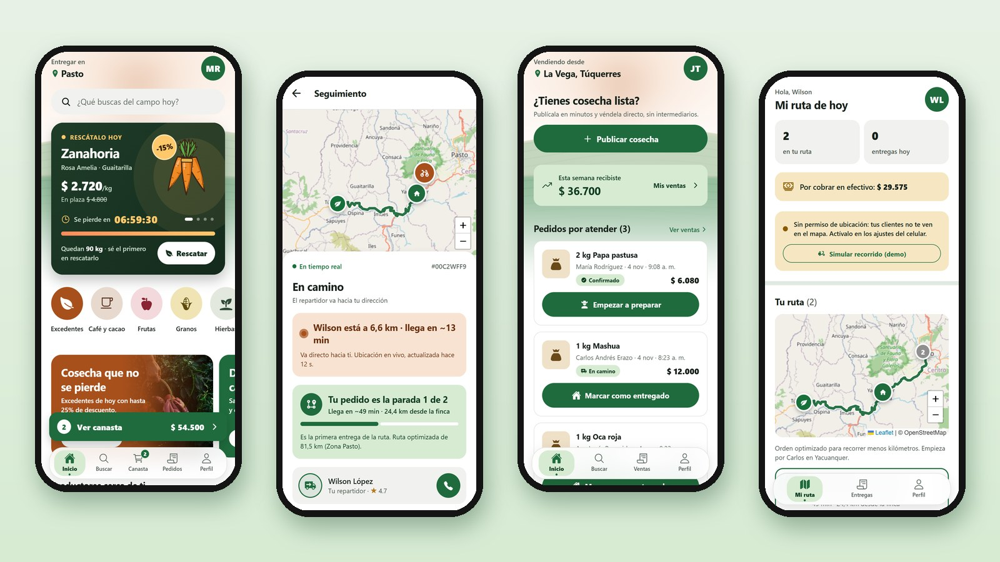
</p>

---

## 📸 Capturas

Una sola app con tres roles: quien compra, quien cultiva y quien reparte.

### Comprador

<table>
  <tr>
    <td align="center" width="25%">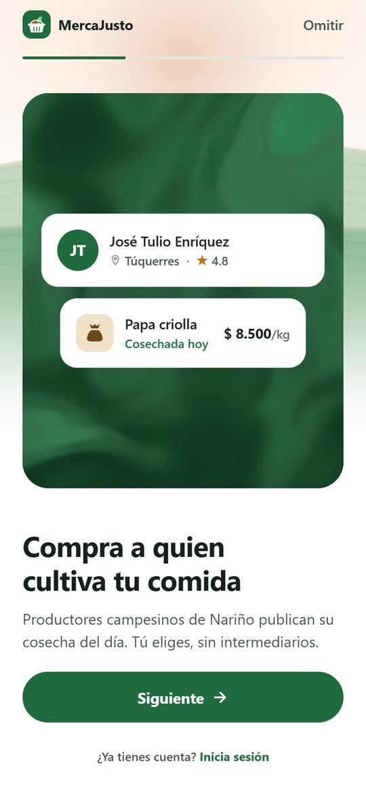<br><sub><b>Bienvenida</b></sub></td>
    <td align="center" width="25%">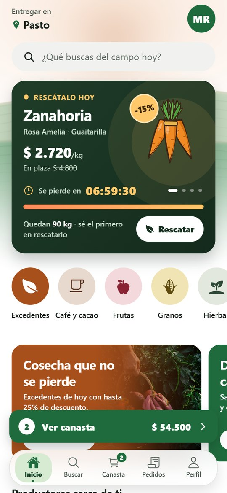<br><sub><b>Inicio</b> · cosechas que se pierden primero, con cuenta regresiva</sub></td>
    <td align="center" width="25%">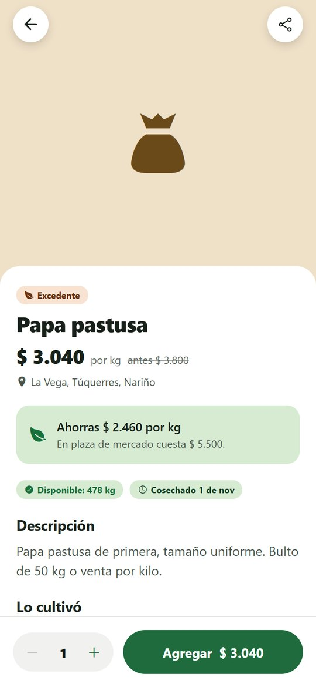<br><sub><b>Producto</b> · precio frente a la plaza</sub></td>
    <td align="center" width="25%">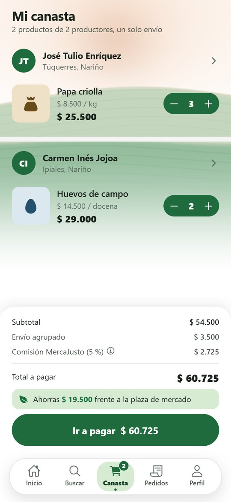<br><sub><b>Canasta</b> · un solo envío para varios productores</sub></td>
  </tr>
  <tr>
    <td align="center">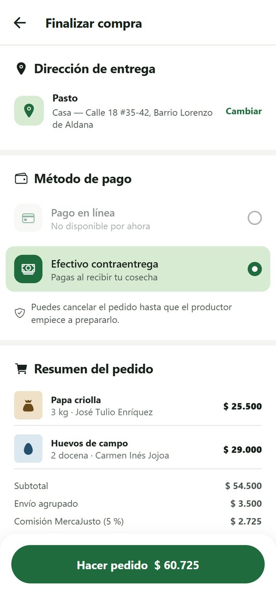<br><sub><b>Pago</b> · efectivo contraentrega o en línea</sub></td>
    <td align="center">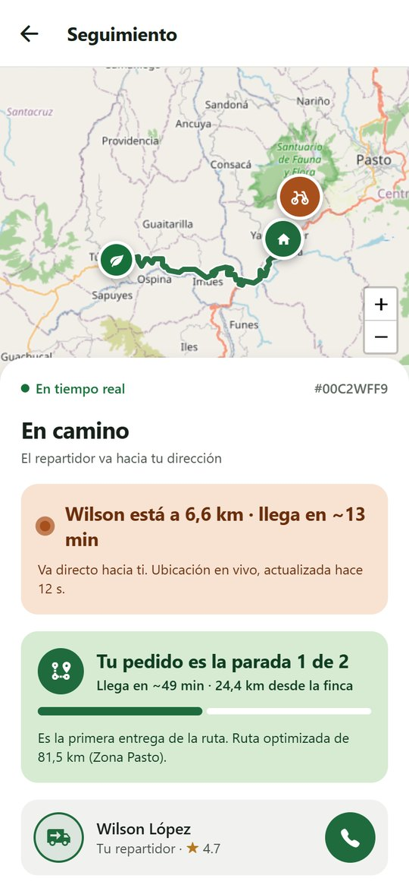<br><sub><b>Seguimiento en vivo</b> · el repartidor en el mapa</sub></td>
    <td align="center">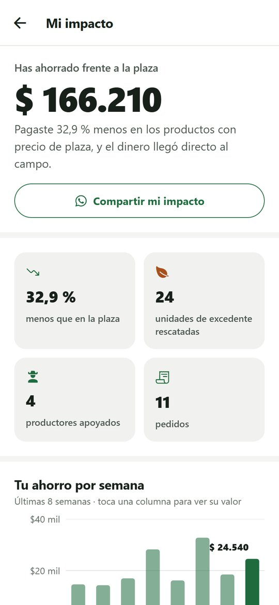<br><sub><b>Mi impacto</b> · cuánto ahorraste y a quién le compraste</sub></td>
    <td></td>
  </tr>
</table>

### Productor

<table>
  <tr>
    <td align="center" width="25%">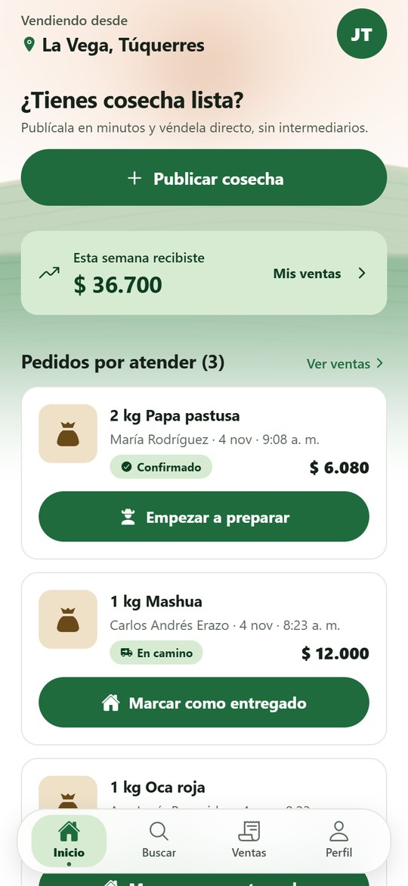<br><sub><b>Inicio</b> · pedidos por atender y lo recibido</sub></td>
    <td align="center" width="25%">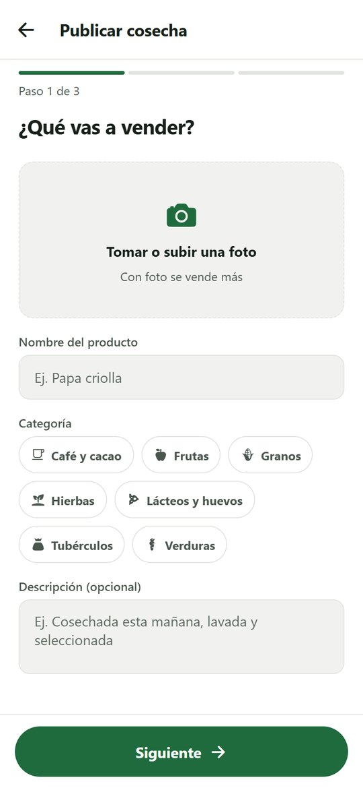<br><sub><b>Publicar cosecha</b> · en tres pasos</sub></td>
    <td align="center" width="25%">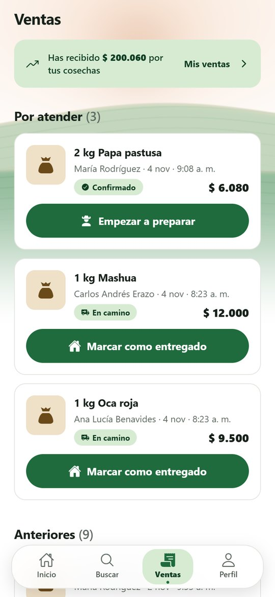<br><sub><b>Ventas</b> · avanzar cada pedido</sub></td>
    <td width="25%"></td>
  </tr>
</table>

### Repartidor

<table>
  <tr>
    <td align="center" width="25%">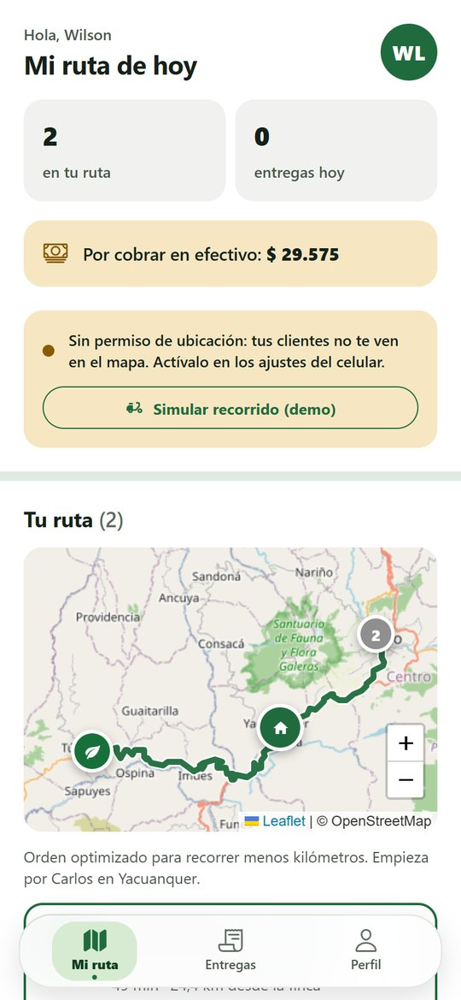<br><sub><b>Mi ruta</b> · entregas ordenadas para recorrer menos kilómetros</sub></td>
    <td align="center" width="25%">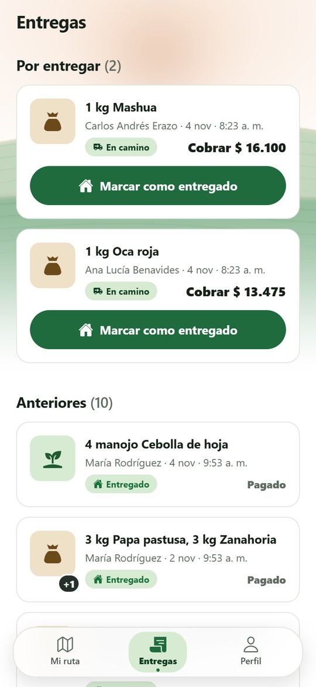<br><sub><b>Entregas</b> · cuánto cobrar en cada puerta</sub></td>
    <td width="25%"></td>
    <td width="25%"></td>
  </tr>
</table>

### Modo oscuro

<table>
  <tr>
    <td align="center" width="25%">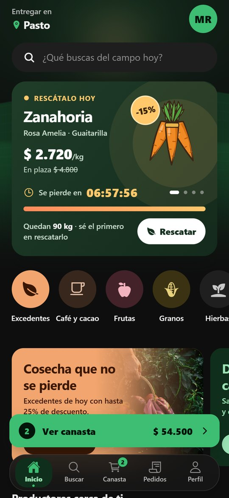<br><sub><b>Inicio</b></sub></td>
    <td align="center" width="25%">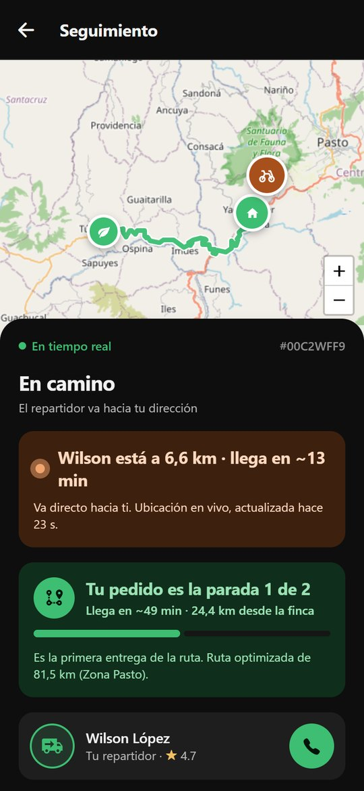<br><sub><b>Seguimiento</b></sub></td>
    <td align="center" width="25%">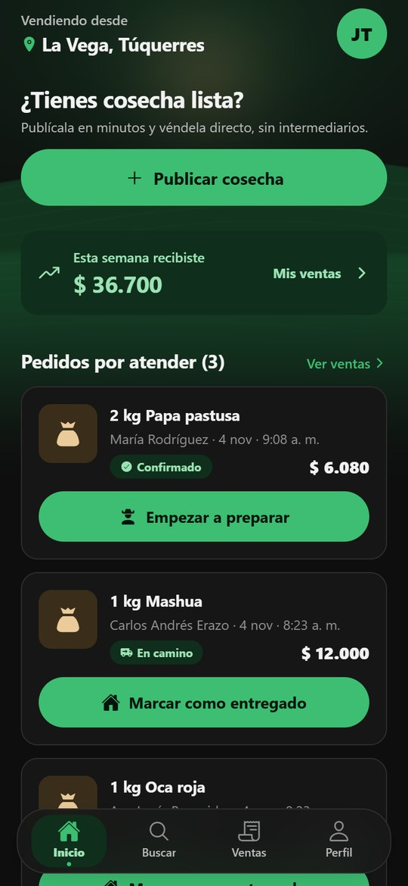<br><sub><b>Productor</b></sub></td>
    <td width="25%"></td>
  </tr>
</table>

---

## 📁 Estructura del monorepo

```
MercaJusto/
├── css/global.css            # Design tokens
├── backend/                  # API REST — Node + Express + TypeScript + Prisma
│   ├── prisma/schema.prisma  # Modelo de datos (PostgreSQL)
│   ├── prisma/seed.ts        # Datos demo reales de Nariño
│   ├── src/routes/           # Endpoints (auth, productos, carrito, pedidos, rutas, métricas)
│   ├── src/lib/              # JWT, OTP, push, precios, motor de rutas (VRP)
│   └── docker-compose.yml    # Postgres+PostGIS opcional
└── mobile/                   # App móvil — React Native + Expo + TypeScript
    ├── app/                  # Pantallas (Expo Router, navegación por archivos)
    ├── src/components/       # Button, Pill, ProductCard, TopBar, Toast...
    ├── src/store/            # Zustand (auth, carrito, tema, avisos)
    ├── src/lib/              # Precios, diálogos, estados de pedido, notificaciones
    └── src/api/              # Cliente axios + tipos
```

---

## 🚀 Puesta en marcha

Requisitos: Node 18+ y, para probar en el celular, la app **Expo Go** (SDK 57, la versión actual de las tiendas).

### 1. Backend + base de datos

```bash
cd backend
npm install
cp .env.example .env     # solo la primera vez
npm run setup            # aplica migraciones, genera Prisma y carga datos demo
npm run dev              # API en http://localhost:4000
```

Al arrancar, la consola muestra la URL de la red local (por ejemplo `http://192.168.0.36:4000/api`). Esa es la que usa un celular físico.

Otros comandos:

```bash
npm run db:seed:demo     # Repoblar con datos demo (borra lo existente)
npm run db:reset         # Borrar y recrear la base + seed
npm run prisma:studio    # Ver la base de datos en el navegador
npm run test:routing     # Prueba del motor de rutas (k-means + 2-opt)
```

### 2. App móvil

```bash
cd mobile
npm install
npm start                # Escanea el QR con Expo Go (mismo Wi-Fi que el PC)
npm run web              # Abrir la app en el navegador
npm run android          # Emulador Android
npm run typecheck        # Verificar tipos TypeScript
```

La app detecta sola la IP del PC en Expo Go y usa `10.0.2.2` en el emulador Android. Si algo no conecta, define la URL explícitamente en `mobile/.env`:

```bash
EXPO_PUBLIC_API_URL=http://192.168.0.36:4000
```

Las capturas de arriba son de la versión web con los datos demo (`npm run db:seed:demo`).

## 📄 Licencia

Uso académico. Todos los derechos reservados al autor.

Hecho con ❤️ en Nariño, Colombia.
